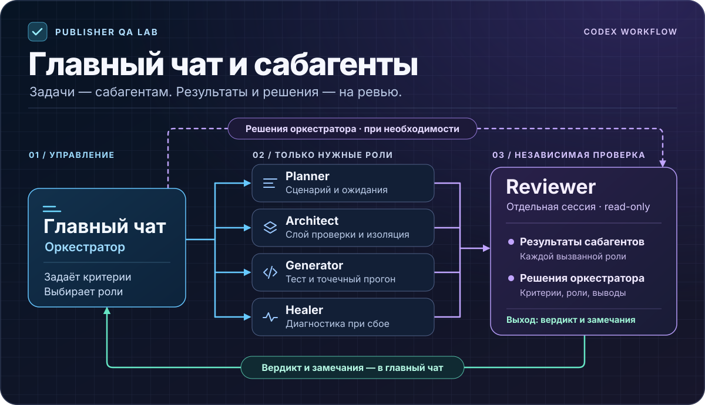

# publisher-qa-lab

## [PR #1](https://github.com/Allgood07/publisher-qa-lab/pull/1/files): конфликт черновиков

Устаревшая вкладка не должна перезаписывать свежий черновик. Первую версию тестов не приняли: проверка наличия правильной V1 у гостя не исключала показ черновика V2 рядом с ней. На [контрольной копии с таким поведением](https://github.com/Allgood07/publisher-qa-lab/blob/73a5560c45db97b433007f2aa5ffad12c388e81f/docs/draft-conflict.md#локальная-приёмка) старые проверки прошли 3/3; после добавления проверок на отсутствие заголовка и текста V2 упали оба теста конфликта.

На принятой ревизии `93ce1d3` [API-spec](https://github.com/Allgood07/publisher-qa-lab/blob/93ce1d38a82fd2f912e3ee1e2615c7799b48d286/tests/api/draft-revision.spec.ts#L8-L44) проверяет `409`, сохранность черновика и ревизии, а также V1 без полей V2 в публичном HTML. [UI-spec](https://github.com/Allgood07/publisher-qa-lab/blob/93ce1d38a82fd2f912e3ee1e2615c7799b48d286/tests/e2e/draft-conflict.spec.ts#L10-L53) проверяет предупреждение и ручной перенос правки, а у независимого гостя — V1 без полей V2 до публикации и новый снимок после. [Штатный CI на `93ce1d3`](https://github.com/Allgood07/publisher-qa-lab/actions/runs/45813147954) прошёл TypeScript и Playwright с Chromium; контрольную копию в CI не запускали.

Это локальный стенд с тестами на TypeScript и Playwright. [Проверка своей страницы на Site.pro](docs/sitepro-check.md) через штатный UI — отдельная работа.

## Оркестратор и сабагенты Codex

<picture>
  <source media="(max-width: 600px)" srcset="docs/assets/codex-workflow-mobile.svg">
  
</picture>

Главный чат задаёт критерии и подключает только нужные роли. В отдельной сессии `read-only` Reviewer может проверить результат каждого вызванного сабагента, а при необходимости — и решения оркестратора: границы задачи, выбор ролей и выводы из проверок. Вердикт возвращается в главный чат, который принимает результат или отправляет его на доработку.

В [учебном прогоне Codex](docs/codex-roles.md) на временном проекте Reviewer заметил, что тест сравнивает результат с тем же объектом, который передаёт сервису. Generator разделил вход и эталон. Автор проверил это намеренной подменой данных: старый тест прошёл, исправленный — поймал ошибку. **Локальные тесты и CI запускаются без ИИ.**

В [ручной серии Reviewer](https://github.com/Allgood07/publisher-qa-lab/blob/ec1b5ce9fc45d7b2d33957957953f10a83c390a4/reports/reviewer-eval-423a2b5.md#результат) было восемь задач по три попытки — 24 ответа, не 24 разных задачи. Все вердикты совпали с эталоном; разметку сверяла другая модель, не человек. Вывод: использовать Reviewer как вспомогательную проверку на подобных коротких diff, не для автоматического одобрения.

Сохранённые ответы можно пересчитать локально без модели: `node evals/reviewer/score.mjs reports/reviewer-eval-423a2b5-run.json`. [Задание CI для проверки корпуса и пересчёта](https://github.com/Allgood07/publisher-qa-lab/blob/73a5560c45db97b433007f2aa5ffad12c388e81f/.github/workflows/qa.yml#L12-L30) добавлено в `portfolio-finish` на `73a5560`; в проверенном `main` его нет.

## Запуск

Node.js 22.18 или новее. Из корня репозитория:

```sh
npm ci
npx playwright install chromium
npm run typecheck
npm test
```

Сервер запускается автоматически и отдельно для каждого теста. Для Linux без системных зависимостей браузера: `npx playwright install --with-deps chromium`.

| Команда | Что запускает |
| --- | --- |
| `npm test -- tests/api` | HTTP-проверки без браузера |
| `npm test -- tests/integration` | Проверки наблюдаемого состояния через API и UI |
| `npm test -- tests/e2e` | Сценарии автора и посетителя |
| `npm run test:cleanup` | Намеренное падение внутри Playwright. Итоговый код `0` — только если распознано контрольное падение и подтверждена остановка по PID и TCP |

Локальный HTML-отчёт: `npx playwright show-report`. На `ec1b5ce` [штатный QA-прогон](https://github.com/Allgood07/publisher-qa-lab/actions/runs/45817300002) прошёл TypeScript и Playwright с Chromium. [GitHub Actions](.github/workflows/qa.yml) сохраняет созданный отчёт после успешного или упавшего тестового прогона, если запуск не отменён: **QA → запуск → Artifacts → `playwright-report`**.

## Структура

```text
src/                       # учебное приложение под тестом
tests/
  api/                     # HTTP-контракт
  integration/             # связь HTTP-запроса и видимого состояния
  e2e/                     # пользовательские маршруты
  support/
    fixtures/              # сборка зависимостей и очистка ресурсов
    pages/                 # POM: локаторы и UI-действия
    clients/               # API-клиент локального сервиса
    data/                  # детерминированные тестовые данные
    assertions.ts          # общая проверка текста публикации
    layout.ts              # DOM-измерения
scripts/                   # исполняемые проверки teardown
.codex/agents/             # определения сабагентов
```

- [Архитектура, выбор слоя и результаты прогонов](docs/test-architecture.md)
- [Инструкции для агентов](AGENTS.md) и [процесс независимого ревью](docs/reviewer.md)
