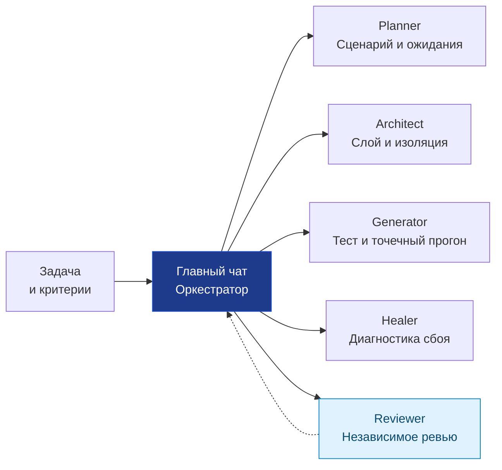

# publisher-qa-lab

Локальный стенд публикации страниц и **15 тестов на TypeScript и Playwright**. Набор проверяет HTTP-контракт, сохранность черновика и опубликованного снимка, действия автора и отображение страницы на узком экране. [Проверка своей страницы на Site.pro](docs/sitepro-check.md) через штатный UI — отдельная работа.

## Оркестратор и подагенты Codex



Главный чат выбирает нужные роли, задаёт критерии и решает, принять результат или вернуть на доработку. Healer подключается при падении. Reviewer проверяет изменения в новой сессии, запущенной в режиме `read-only`: получает diff и результаты прогонов, а не историю реализации.

В [учебном прогоне Codex](docs/codex-roles.md) на временном проекте Reviewer заметил, что тест сравнивает результат с тем же объектом, который передаёт сервису. Generator разделил вход и эталон. Автор проверил это намеренной подменой данных: старый тест прошёл, исправленный — поймал ошибку. **Локальные тесты и CI запускаются без ИИ.**

## Запуск

Node.js 22.18 или новее. Из корня репозитория:

```sh
npm ci
npx playwright install chromium
npm run typecheck
npm test
```

Ожидается `15 passed`. Сервер запускается автоматически и отдельно для каждого теста. Для Linux без системных зависимостей браузера: `npx playwright install --with-deps chromium`.

| Команда | Что запускает |
| --- | --- |
| `npm test -- tests/api` | 7 HTTP-проверок без браузера |
| `npm test -- tests/integration` | 5 проверок наблюдаемого состояния через API и UI |
| `npm test -- tests/e2e` | 3 сценария автора и посетителя |
| `npm run test:cleanup` | В Playwright ожидается `1 failed`. Итоговый код `0` — только если распознано контрольное падение и обе проверки подтвердили остановку по PID и TCP |

Локальный HTML-отчёт: `npx playwright show-report`. [GitHub Actions](.github/workflows/qa.yml) сохраняет созданный отчёт после успешного или упавшего тестового прогона, если запуск не отменён: **QA → запуск → Artifacts → `playwright-report`**. Для структуры из 15 тестов подтверждён локальный прогон; удалённый ещё не проверен.

## Структура

```text
src/                       # учебное приложение под тестом
tests/
  api/                     # HTTP-контракт
  integration/             # связь HTTP-запроса и видимого состояния
  e2e/                     # пользовательские маршруты
  support/
    fixtures/              # сборка зависимостей и очистка ресурсов
    pages/                 # POM: локаторы и UI-действия
    clients/               # API-клиент локального сервиса
    data/                  # детерминированные тестовые данные
    assertions.ts          # общая проверка текста публикации
    layout.ts              # DOM-измерения
scripts/                   # исполняемые проверки teardown
.codex/agents/             # определения подагентов
```

- [Архитектура, выбор слоя и результаты прогонов](docs/test-architecture.md)
- [Инструкции для агентов](AGENTS.md) и [процесс независимого ревью](docs/reviewer.md)
